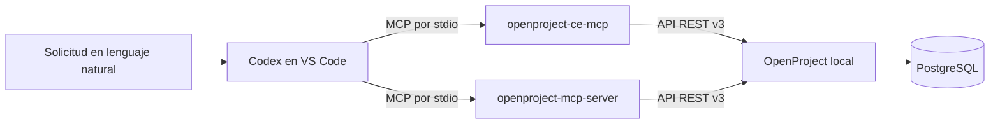

# OpenProject + Codex mediante MCP

Prueba de concepto de una integración **que instalé, configuré y probé** para operar OpenProject desde Codex en Visual Studio Code mediante solicitudes en lenguaje natural. El objetivo era explorar si una interfaz conversacional podía agilizar consultas y tareas habituales de gestión de proyectos sin sustituir a OpenProject como sistema de registro.

Utilicé dos servidores MCP **desarrollados por terceros**: [openproject-ce-mcp, de jtauschl](https://github.com/jtauschl/openproject-ce-mcp), y [openproject-mcp-server, de gerke-homelab](https://github.com/gerke-homelab/openproject-mcp-server). Mi trabajo consistió en investigar las opciones, instalarlas, configurar su acceso, conectarlas con Codex, probarlas y documentar los resultados. No desarrollé ninguno de los servidores.

## Tecnologías utilizadas

OpenProject Community Edition y su API REST v3; Docker Desktop y PostgreSQL para el entorno local; Model Context Protocol (MCP); Codex en Visual Studio Code; Python y `pipx` para el primer servidor; Git y `uv` para el segundo.

## Arquitectura

Los servidores MCP se ejecutaron como procesos locales iniciados por Codex. Cada uno usó una clave de API de OpenProject, cuyos permisos seguían siendo efectivos con independencia de las herramientas visibles en Codex.

## Implementación paso a paso

1. **Preparé OpenProject.** La instancia Community Edition corría en Docker Desktop con PostgreSQL y estaba accesible en `http://localhost:8080`. Habilité el acceso a la API v3 y generé un token personal para la cuenta de prueba.
2. **Instalé el primer MCP.** Con Python y `pipx`, ejecuté `py -m pipx install openproject-ce-mcp` y luego `openproject-ce-mcp configure`.
3. **Configuré acceso y permisos.** En la primera pasada elegí configuración en el proyecto (`global: N`, `project-scoped: Y`), cliente Codex (`Y`) y escritura (`N`). Luego repetí el asistente con escritura (`Y`) limitada a un proyecto de prueba. Activé paquetes de trabajo, proyectos, membresías y tableros (`Y`); dejé versiones y reuniones en `N`. La configuración final de la PoC amplió el alcance de escritura a `*` para completar pruebas de creación de proyectos. **Ese comodín, al igual que la lectura `*`, fue una configuración de laboratorio y no es recomendable para producción.**
4. **Conecté el primer MCP con Codex.** El asistente registró `openproject` en el `config.toml` del proyecto abierto en VS Code. Codex lo inició por `stdio` mediante el ejecutable instalado con `pipx`.
5. **Instalé el segundo MCP.** Cloné `gerke-homelab/openproject-mcp-server`, ejecuté `uv sync` y usé su ejecutable del entorno virtual. Lo añadí porque en la configuración probada del primer MCP no apareció una herramienta utilizable para crear usuarios.
6. **Registré ambos servidores.** Añadí el segundo como `openproject_admin` y limité sus herramientas visibles a `create_user,get_user,list_users`. Este filtro reduce el catálogo de herramientas; no reemplaza la autorización de OpenProject.
7. **Verifiqué las conexiones.** Tras recargar Codex, comprobé que ambos servidores aparecían y consulté identidad, proyectos y usuarios antes de las operaciones de escritura. Después de cada cambio, hice consultas de lectura para comprobar el resultado.

El [paso a paso técnico](docs/instalacion.md) conserva los comandos y las respuestas `Y/N` documentadas. [La configuración de ejemplo](examples/config.toml.example) contiene solo valores ficticios.

## Pruebas y resultados

El registro de la PoC documenta estas operaciones **verificadas históricamente**; este repositorio no reproduce pruebas ni afirma reflejar el estado actual de la instancia:

| Área | Resultado comprobado |
| --- | --- |
| Consultas | Lectura de proyectos, subproyectos y paquetes de trabajo; consulta de información y registros de tiempo. |
| Incidentes | Creación y modificación de incidentes; cambios de estado, prioridad y asignación; comentarios y horas. |
| Proyectos | Creación de un proyecto privado y un subproyecto; consulta de sus datos. |
| Membresías | Asignación de personas a proyectos y subproyectos con roles. |
| Usuarios | Creación y consulta de un usuario mediante el segundo MCP. |
| Flujo combinado | Alta de usuario con el segundo MCP, membresía e incidente asignado con el primero, todo desde Codex. |

Ejemplos ilustrativos, con **datos completamente ficticios** (no son transcripciones ni resultados reales):

| Solicitud a Codex | Resultado esperado según la operación verificada |
| --- | --- |
| «Mostrame los incidentes abiertos del proyecto Demo Alfa». | Lista de paquetes de trabajo visibles para la cuenta. |
| «Creá un incidente de prueba en Demo Alfa, prioridad Media». | Nuevo incidente con sus datos consultables. |
| «Asigná el incidente de prueba a Usuario Ejemplo y registrá 30 minutos». | Asignación y entrada de tiempo consultables. |
| «Creá un usuario de prueba, agregalo al subproyecto Demo Beta y asignale un incidente». | Usuario, membresía e incidente comprobables en consultas posteriores. |

**No quedó comprobada** la creación de un tablero Kanban visual. Las herramientas observadas para tableros o consultas guardadas no demostraron la creación de esa vista. Tampoco se probaron cambios administrativos en las definiciones de estados, tipos o flujos de trabajo. Las escrituras de versiones y reuniones estaban deshabilitadas en la configuración probada.

## Aplicación en un entorno empresarial

Una integración de este tipo podría reducir tareas manuales y repetitivas, permitir consultas en lenguaje natural y facilitar el registro y seguimiento de incidentes, proyectos y horas. El patrón de herramientas modulares también podría centralizar interacciones con varios sistemas en un mismo asistente y servir de base para agentes especializados.

Conectar en el futuro otros sistemas, como SAP, Jira o gestores documentales, sería un proyecto separado: **no fue parte de esta PoC**. Tampoco se midieron mejoras de productividad. Para una adopción empresarial harían falta controles de acceso por persona y proyecto, auditoría, protección de credenciales, monitoreo, confirmación de acciones sensibles y evaluación de riesgos. Un filtro de herramientas MCP no equivale a una política de permisos del sistema de origen.

## Limitaciones y conclusiones

La PoC demostró que Codex podía consultar y modificar OpenProject mediante MCP, y que los dos servidores podían encadenar operaciones en un mismo flujo. El primer servidor cubrió la gestión operativa; el segundo completó el alta de usuarios en la configuración ensayada. Esto no significa que siempre sean necesarios dos servidores.

El resultado dependía de procesos locales, permisos de API y dos proyectos externos con mantenimiento independiente. La vista Kanban visual y la edición de flujos administrativos quedaron sin verificar. Aprendí que la viabilidad técnica de una integración conversacional debe acompañarse de límites de acceso, verificación posterior de cada escritura y un diseño de seguridad y operación antes de llevarla a producción.
